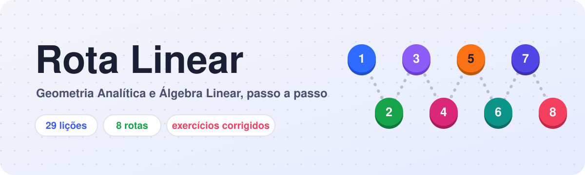

<p align="center">
  
</p>

<p align="center">
  
  
  
  
  
</p>

**Rota Linear** é um site para **aprender** Geometria Analítica e Álgebra Linear (GAAL) em lições curtas. Cada lição alterna explicação, gráfico interativo, uma tarefa com objetivo, uma previsão antes de ver a resposta e perguntas com correção na hora. Depois vem a prática com exercícios gerados, que nunca se repetem, e o progresso fica salvo no próprio navegador.

São **8 rotas** e **29 lições**, de vetores até mínimos quadrados, com figuras 2D e 3D.

---

## Como é uma lição

Cada lição tem de 5 a 8 cartões, de quatro tipos:

| Cartão | O que você faz |
|---|---|
| 💡 **Ideia** | Lê uma explicação curta, com a fórmula colorida igual aos objetos do gráfico. Muitas figuras são animadas. |
| 🎯 **Tarefa** | Mexe no gráfico (arrasta pontos, move controles, digita uma matriz) até cumprir um objetivo, como “deixe u ⟂ v” ou “achate o cubo”. Uma leitura ao vivo mostra os números. Se travar, o botão **Me mostra** anima a solução. |
| 👁️ **Preveja** | Antes de ver, escolhe uma opção ou arrasta um ponto até onde acha que a resposta vai parar. Depois a figura revela a verdade e explica o porquê. Errar aqui não conta. |
| ✅ **Pergunta** | Responde e confere: número, vetor, matriz, múltipla escolha ou ponto no gráfico. No primeiro erro vem uma dica; no segundo, a resposta com a explicação. |

No fim, a lição mostra os acertos de primeira, as fórmulas que foram para a ficha e o caminho para a prática.

## As 8 rotas

| # | Rota | Lições |
|:-:|---|---|
| 1 | **Setas e produtos** | Somar e esticar vetores · O ângulo pelo produto escalar · Área e volume com produtos *(3D)* |
| 2 | **Retas, planos e distâncias** | Quatro jeitos de escrever uma reta · Cruzamentos, ângulos e distâncias · Retas atravessando o espaço *(3D)* · O plano e seu vetor normal *(3D)* · Reversas, paralelas ou secantes *(3D)* |
| 3 | **Curvas do 2º grau** | Elipse: a soma que não muda · Hipérbole: a diferença que não muda · Parábola: foco e diretriz · Qual cônica é essa? |
| 4 | **Superfícies do 2º grau** | Cortando quádricas em fatias *(3D)* |
| 5 | **Equações e matrizes** | Onde as equações se encontram · Escalonar sem mudar a resposta · Determinante: área com sinal · Multiplicar, transpor, inverter |
| 6 | **Bases e subespaços** | Até onde dois vetores alcançam · Quando um conjunto é subespaço *(3D)* · Trocar de régua: mudança de base · O que a matriz apaga e o que alcança *(3D)* |
| 7 | **Matrizes que movem** | As colunas são destinos · Encadear e desfazer · Girar, refletir e achatar no espaço *(3D)* |
| 8 | **Autovetores e projeções** | Direções que só esticam · Diagonalizar é trocar de eixos · Autoespaços em 3D *(3D)* · Endireitar uma base · A reta que mais se aproxima |

A ordem é só uma sugestão: nenhuma lição fica bloqueada.

## Exercícios que não acabam

- Cada lição tem de 3 a 4 **geradores**. Cada um monta exercícios com números “bonitos” por construção: determinantes que não zeram quando não podem, autovalores inteiros (montados como PDP⁻¹), frações com denominador pequeno.
- **Tipos de resposta:** número, vetor, matriz, múltipla escolha, ponto arrastado no gráfico, equação de reta ou plano (qualquer múltiplo vale) e direção (qualquer múltiplo não nulo de um autovetor ou de um vetor do núcleo vale).
- O leitor de respostas entende `2,5` e `2.5`, `3/4`, `√2`, `2√3`, `π` e contas simples. No celular, uma barra de teclas traz `− / √ π ,` para perto do teclado.
- Toda questão tem **dica** e **solução passo a passo**.
- **Prática:** 6 exercícios em dificuldade crescente. Acertar 5 de 6 deixa a lição **dominada ★**.

## Progresso e revisão

- O progresso fica salvo no **navegador**: em que cartão você parou, as lições concluídas e dominadas, os dias seguidos de estudo e os erros. Não tem conta, servidor nem rastreamento. Sem armazenamento disponível, o site funciona normalmente, só não lembra o que foi feito.
- **Revisão misturada:** 8 exercícios das lições já feitas, com mais peso no que você errou e no que não pratica há dias.
- **Desafio da rota:** exercícios de todas as lições da rota, misturados.
- **Fichas de fórmulas:** um resumo por rota (ou todas juntas), pronto para imprimir.

## Feito para o celular

- Em pé, a figura fica em cima e o botão de ação fica fixo embaixo. Deitado, a figura e o cartão ficam lado a lado, e o texto rola dentro do cartão.
- Tema claro e escuro, com as cores dos gráficos ajustadas para os dois.
- Funciona pelo teclado do início ao fim: Enter confere e continua, as setas movem os pontos arrastáveis, e o retorno é anunciado para leitores de tela.
- O three.js só é baixado nas lições 3D. O resto do site é leve.

## Rodando no seu computador

Precisa do [Node.js](https://nodejs.org) 20.19 ou mais novo (ou 22.12+).

```bash
npm install
npm run dev      # abre o site em modo de desenvolvimento
npm test         # roda os testes
npm run build    # gera a versão final em dist/
```

O `dist/` é estático: pode ser servido por qualquer hospedagem de arquivos.

## Como o projeto está organizado

```
src/
├── lessons/      uma lição por arquivo (A1.tsx … H5.tsx), feita com os cartões ideia/tarefa/prever/pergunta
├── exercises/    geradores de exercício, um arquivo por rota (A.ts … H.ts)
├── learn/        catálogo das rotas, tipos, correção das respostas, sorteio e progresso
├── player/       telas de lição e de prática, cartões, entrada de respostas
├── pages/        início, rotas, revisão, fichas e sobre
├── math/         vetores, matrizes, escalonamento, cônicas, quádricas, autovalores, Gram–Schmidt…
├── viz2d/        figuras 2D (sobre o Mafs): setas, retas, curvas, grades, pontos arrastáveis
├── viz3d/        cenas 3D (sobre o three.js): planos, retas, superfícies, paralelepípedos
├── ui/           controles, ícones, navegação e fórmulas (KaTeX)
└── styles/       tokens de cor e tema, componentes e telas
tests/            matemática, leitor de respostas, todos os geradores e todas as lições
```

## Testes

`npm test` roda 215 testes. Entre eles:

- **Cada gerador** é sorteado com 300 sementes. A resposta dele precisa passar no próprio corretor, uma resposta errada típica precisa ser recusada, e todo o TeX do enunciado, da dica e da solução precisa ser válido.
- **Cada lição:** o estado de solução de toda tarefa cumpre o objetivo (e o estado inicial não), toda pergunta aceita a própria resposta e toda fórmula renderiza.
- A matemática de base: produtos, escalonamento, classificação de cônicas e quádricas, autovalores 2×2 e 3×3, Gram–Schmidt e mínimos quadrados.

## Laboratório irmão

O [**Equação Viva**](https://falow1.github.io/equacao-viva/) cobre os mesmos 29 temas em modo livre, com o gráfico e a equação ligados nos dois sentidos e sem roteiro. Cada lição do Rota Linear tem um link para o módulo correspondente de lá.

## Créditos

Trabalho da disciplina de **Geometria Analítica e Álgebra Linear**, na **UNEMAT**.

**Integrantes:** Gabriel Egnes, Gabriel Vinicius, Gustavo, Rhonny e Lairo.

Feito com [React](https://react.dev), [TypeScript](https://www.typescriptlang.org), [Vite](https://vite.dev), [Mafs](https://mafs.dev), [three.js](https://threejs.org) / [React Three Fiber](https://r3f.docs.pmnd.rs), [KaTeX](https://katex.org) e a fonte [Nunito](https://fonts.google.com/specimen/Nunito).
